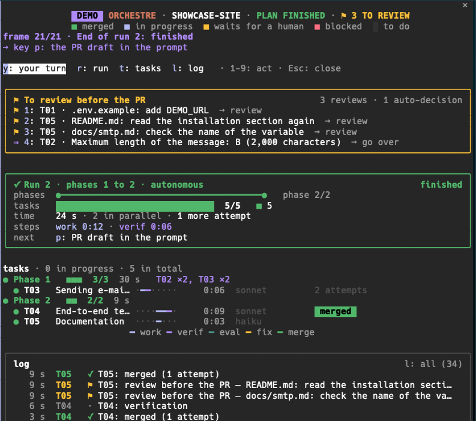
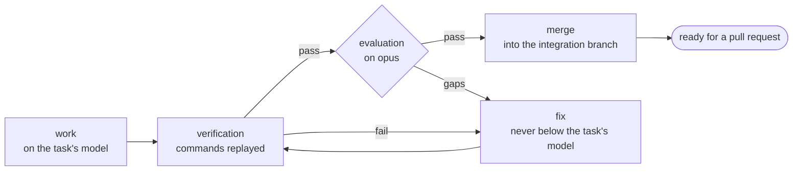

<p align="center">
  <picture>
    <source media="(prefers-color-scheme: dark)" srcset="brand/readme-banner-dark.gif">
    
  </picture>
</p>

<p align="center">
  <strong>Write the plan. orchestre plays it through.</strong><br>
  A plugin for Claude Code.
</p>

<p align="center">
  
  
  
</p>

<p align="center">
  <a href="#use">Use</a> ·
  <a href="#why-orchestre">Why</a> ·
  <a href="#install">Install</a> ·
  <a href="#reference">Reference</a> ·
  <a href="docs/reference.md">Docs</a>
</p>

A long dev plan does not fit in one Claude Code session: the context fills up, and someone has to track what is done, what failed and what is left. orchestre splits the work into a plan of phases and tasks, and runs it with a team of agents. Each task is done on its own branch, in its own worktree when tasks run side by side, then verified, evaluated and merged into an integration branch, until that branch is ready for a pull request. You step in only when a decision is yours.

**Follow a long run without watching it.** A banner above the prompt shows the phase, the progress and the task in progress. `/progress` opens a pane: what waits for you comes first, one key per action, then the run, the tasks as timelines and the log. A notification comes only when a task needs you or a run stops, and when you come back after a break, one says what changed. To see it without a run: `/progress demo`.

<p align="center">
  
  <br>
  <em>The <code>/progress</code> pane, last frame of <code>/progress demo</code>: what waits for you comes first, one key per action.</em>
</p>

## Use

Once orchestre is [installed](#install), at the root of your repository, on its base branch, with no uncommitted change:

```
/orchestre:prepare <goal or existing plan>   # write the plan: phases, tasks, decisions
/orchestre:ready plans/<name>                # the day before: settings, prerequisites, dry run
/orchestre:run plans/<name>                  # in a new session: one run per phase, up to the PR
/orchestre:status                            # where the plan stands, even during a run
/progress                                    # the live pane: what waits for you
```

- `/orchestre:prepare` installs orchestre in the repository first if needed. It gives each task a model, and asks every open decision; you can defer some.
- `/orchestre:run` asks the mode: stop at each phase (advised for a first plan), stop on a major deviation, or autonomous.
- At the end, `plan/<name>` is ready for a pull request. The summary lists the auto-decisions and the files to review, and <kbd>p</kbd> in `/progress` drafts the PR text. Pushing, merging into `main` and deploying stay with you.

The path of each task during a run:



After two fixes by default, a task still rejected stops as blocked, with the exact reason. Every option and key: [Reference](#reference).

## Why orchestre

<table>
  <tr>
    <td width="33%" valign="top">
      <strong>Isolated work</strong><br>
      Each task has its own branch, <code>task/&lt;id&gt;</code>, and its own worktree when tasks run side by side. It is merged with <code>--no-ff</code> into <code>plan/&lt;name&gt;</code>. No agent pushes, merges into <code>main</code> or deploys.
    </td>
    <td width="33%" valign="top">
      <strong>Evaluation on evidence</strong><br>
      A verifier replays the task's verification commands. An evaluator on opus judges each criterion of done on the diff and those results, not on what the worker says it did. Up to two fixes follow by default (<code>max_fixes</code>).
    </td>
    <td width="33%" valign="top">
      <strong>A model per task</strong><br>
      The preparation gives each task haiku, sonnet or opus, with a one-line reason; fable only on the tasks you choose. A fix never runs on a model below the task's.
    </td>
  </tr>
  <tr>
    <td width="33%" valign="top">
      <strong>Scripts for the state, agents for the work</strong><br>
      Node scripts without dependencies validate the plan (<code>plan-lint.mjs</code>), write the progress (<code>progress.mjs</code>) and the settings (<code>settings.mjs</code>), and clean up the worktrees. The agents write the code and make the judgment calls.
    </td>
    <td width="33%" valign="top">
      <strong>A human only when needed</strong><br>
      Real data, secrets, production and deployment stay yours. A file the agents may not touch becomes a review to do before the pull request, without stopping the run.
    </td>
    <td width="33%" valign="top">
      <strong>Resume and follow</strong><br>
      An interrupted run is never continued: the next <code>/orchestre:run</code> starts a new run from the plan and git, and skips the merged tasks. A banner and the <code>/progress</code> pane show what waits for you.
    </td>
  </tr>
</table>

## Install

This repository is the plugin marketplace `circle`; orchestre is its only plugin. Once per machine, in a Claude Code session:

```
/plugin marketplace add FabienDayuse/circle-claude-plugin
/plugin install orchestre@circle
/reload-plugins
```

<details>
<summary><strong>Requirements</strong>: Claude Code 2.1.287 or later, <code>git</code>, Node.js 18 or later, read access to this repository</summary>

- Claude Code 2.1.287 or later, with dynamic workflows: paid plans; on Pro, the *Dynamic workflows* line of `/config`. The commands need 2.1.271; the progress display needs 2.1.287.
- `git` and Node.js 18 or later.
- Read access to this GitHub repository, private for now: see [Access to the repository](docs/reference.md#access-to-the-repository).

</details>

To try orchestre on a toy repository first: [First try](docs/reference.md#first-try).

## Reference

<details>
<summary><strong>Commands and options</strong></summary>

| Command | What it does |
| :- | :- |
| `/orchestre:prepare <goal or existing plan>` | Converts a written plan, or writes a new one from a goal. Installs orchestre first if needed. |
| `/orchestre:install [--team]` | Writes the repository settings orchestre needs. `--team` also offers the plugin to the people who open the repository. |
| `/orchestre:ready plans/<name> [--no-dry-run]` | Checks that the plan can run, without running any task, and gives a verdict phase by phase. |
| `/orchestre:run plans/<name> [--resume]` | Runs the plan, one workflow run per phase. `--resume` first recalls where the plan stands. |
| `/orchestre:status [plans/<name>]` | Shows the progress of the plan as a table. Read-only, also during a run. |
| `/progress [plans/<name> \| auto]` | Opens the progress pane. A plan path picks the plan; `auto` follows the last one written. |
| `/progress text` | Gives the same state as text. |
| `/progress demo` | Plays two runs of a made-up plan in a little over a minute, without reading or writing the repository. |
| `/progress sound` | Turns on or off a sound when something waits for you (macOS). |

</details>

<details>
<summary><strong>Keys of the <code>/progress</code> pane</strong></summary>

An action key only prepares a text in the prompt: nothing is sent without you.

| Key | Action |
| :- | :- |
| <kbd>y</kbd> <kbd>r</kbd> <kbd>t</kbd> <kbd>l</kbd> | Scroll to "Your turn" (when shown), the run, the tasks or the log. `l` also switches between the short and the whole log. |
| <kbd>1</kbd> to <kbd>9</kbd> | Prepare the action of a line of "Your turn": resume the run, review a file, go over an auto-decision… |
| <kbd>c</kbd> | Prepare `/orchestre:run plans/<name> --resume`, after a run that ended before the plan is finished. |
| <kbd>p</kbd> | Prepare the pull request draft, once the plan is finished. |
| <kbd>Esc</kbd> | Close the pane. |

In the banner, "⤢ Details" opens the pane and, after a run, "✕ Hide" hides the banner. Both are clicked; they have no key.

</details>

More:

- [`docs/reference.md`](docs/reference.md): installation, each command in detail, the progress display, what a run does, known limits, development.
- [`docs/configuration.md`](docs/configuration.md): the settings orchestre writes into a repository, sharing with a team, `orchestre.config.json`.
- [`docs/upgrading.md`](docs/upgrading.md): from 0.12 and from 0.11.
- [Plan format, `format.md`](plugins/orchestre/skills/prepare/format.md): tasks, `PROGRESS.md`, `PREREQUISITES.md`, `HANDOFF.md`, `DISCOVERY.md`, `orchestre.config.json`.
- [`CHANGELOG.md`](CHANGELOG.md).

## Upgrading

Update between two runs, never during one: `/plugin marketplace update circle`, then `/reload-plugins`.

- **From 0.12.** The next `/orchestre:prepare`, `/orchestre:ready` or `/orchestre:run` offers to replace the settings rules of 0.12, in one agreement.
- **From 0.11.** The commands move to English (`/orchestre:lancer` becomes `/orchestre:run`, `/suivi` becomes `/progress`…). `/orchestre:ready` or `/orchestre:run` migrates each plan to the new format, after your agreement.

Details: [`docs/upgrading.md`](docs/upgrading.md).

---

<!-- TODO(license): choose the license with Dayuse, add a LICENSE file, then replace the line below. -->
License: not chosen yet.

orchestre is an independent project, not affiliated with or endorsed by Anthropic. Logo and visual identity: [`brand/`](brand/).
